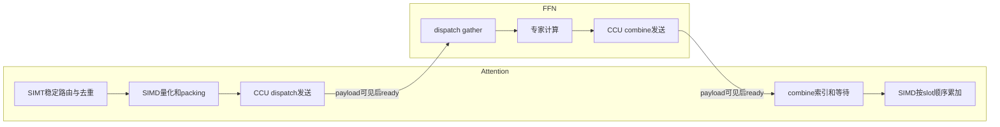

# 四个异步通信算子从 Ascend910C/A3 迁移到 Ascend950/A5 的设计提案

状态：设计提案；2026-10-12。后续实现与编译证据见 [B0基线](../npu/CAM_ASYNC_A5_BASELINE.md)、[P0 MTE流水](../npu/CAM_ASYNC_A5_MTE_PIPELINE.md)、[P1 SIMT路由](../npu/CAM_ASYNC_A5_SIMT_ROUTING.md)、[P2 CCU实验](../npu/CAM_ASYNC_A5_CCU.md)、[P3/P4实验记录](../npu/CAM_ASYNC_A5_PIPELINE_SLOTS.md)、[接收与小批量优化](../npu/CAM_ASYNC_A5_RECEIVE_OPTIMIZATION.md)、[CR同步精简](../npu/CAM_ASYNC_A5_COMBINE_SYNC.md)。源码基线：`bf5bd280b7481358fc0df4a8ec5897b12be73802`。

本提案先定义功能相同的 A5 基线，再比较 MTE 流水、SIMT、CCU 和分块协议方案。设计阶段仅新增本文档，并在独立远程目录编译接口探针；没有改动四算子实现、A5 注册与构建配置，也没有改动远端已有 A5 工程。后续实现以链接中的基线记录为准。这里的“等价”是 Python ABI、routed-only 路由/布局、量化与累加合同、完成通知和允许的调用生命周期相同，不代表 A3/A5 混合通信已获支持。

## 1. 建议路线与选择

| 阶段 | 方案 | 先验证什么 | 预期收益来源 | 协议影响 |
| --- | --- | --- | --- | --- |
| B0 | A5 direct-window/MTE 等价基线 | A5 HCCL 资源与窗口映射、四算子整体编译与 roundtrip | 建立可比较的正确性与性能基线 | 保持 compact-v2 |
| P0 | MTE 双缓冲与 tile 流水 | combine send 的连续搬运、dispatch recv 的 gather 预取 | 重叠 MTE2/MTE3 和向量计算，减少逐 tile 等待 | 保持 compact-v2 |
| P1 | SIMD/SIMT 混合路由和索引 | dispatch 的 stable histogram/scan、rank 内去重 | 减少标量扫描与不规则索引开销 | 保持 compact-v2，允许私有 scratch |
| P2 | CCU 连续段传输 | combine send 的一个 (expert, TP rank) 数据段 | 减少 AIV 搬运占用与 UB 中转 | 保持业务布局/最后 ready，必须证明完成语义 |
| P3 | SIMT 描述符 + CCU 流水 | 设备动态 count/地址到 CCU 的交接 | 重叠路由、packing、传输与后续计算 | 可先保持 compact-v2 |
| P4 | 分块 ready + epoch/credit 多槽协议 | 延迟发送端、空专家、多批 in-flight | 缩短慢 peer 尾部等待，提前处理完整依赖 | 独立新协议，双方一起升级 |

工程实施先做 B0；P0、P1、P2 分别与 B0 比较，避免一次改变多个瓶颈。CCU 首个实验选 combine send，因其已有连续段；SIMT 首个实验选 dispatch 元数据，连续 payload 与量化继续走 SIMD/MTE。最终是否合并 P3，由分阶段测量决定。P4 单独立项，不混入“功能相同”的首次迁移。

## 2. 当前四算子的真实合同

### 2.1 传输路径与外部接口

当前不是四个普通 HCCL Send/Recv collective。Host 用 MC2 创建通信资源，kernel 从 `AscendC::GetHcclContext<HCCL_GROUP_ID_0>()` 取得 A3 `HcclOpResParam`，读取本地 `localWindowsIn` 或远端 `remoteRes[rank].nextDevicePtr -> HcclRankRelationResV2.windowsIn`；AIV 通过 MTE3 写 peer 窗口，接收者通过 MTE2 读本地窗口。`AlltoAll=level0:fullmesh;level1:pairwise` 是资源配置，不能据此认定已经调用了 CCU collective。

以 `A/M/R/T/B/H/K` 表示 Attention ranks、MoE ranks、每 MoE routed experts、Attention TP、单源 batch、hidden 和 top-k：Attention world ranks 为 `[0,A)`，MoE 为 `[A,A+M)`，expert IDs 为 `[0,M*R)`，`T` 整除 `A`。shared expert 在 Attention 本地计算，不进入这四算子的通信。

| 算子 | 输入/输出 | 必须保留的行为 |
| --- | --- | --- |
| dispatch send | FP16/BF16 `x[B,H]`、INT32 `expert_ids[B,K]`；返回 INT8[1] 占位符 | 同 token 命中同一 MoE rank 多个专家，只发一份 payload；每个 assignment 都产生地址表项 |
| dispatch recv | FP16/BF16 单元素 anchor；返回 payload、FP32 scales、INT64 batch_info/counts | 输出按 local expert → 源 TP rank → 源 token 排列；整专家 chunk，不在专家内部拆分 |
| combine send | FP16/BF16 expert results、完整 compact batch_info；返回 INT8[1] 占位符 | 每个 expert/TP 段回到源 Attention 窗口；空 MoE 也发送完成通知 |
| combine recv | FP16/BF16 anchor、原 expert_ids、FP32 weights；返回 [B,H] | 按 top-k slot 原顺序 FP32 multiply/add，最后一次舍入到原 dtype |

`comm_id`、`comm_args` 是保留 ABI 参数，实际通信域由 `group_name` 选择。send 占位符不是收到的数据，也不是远端消费确认。调用返回通常只表示提交到流；源输入和 scratch 必须一直存活到相应设备完成边界。

`dispatch recv` 按 `N=floor(262144*BATCH_SIZE_FACTOR)` 分配容量，只允许使用 metadata 描述的有效行。`batch_info` 长度 `5+T+R*T`：五项为 TP 组总 assignment 数、TP 首 rank、layer、当前 chunk inclusive start/end expert；随后是 T 个此前 MoE 的 prefix，以及 TP-major 的完整 expert counts。整个 batch_info 原样交给 combine send；当前 chunk 行数由返回 counts 求和，不能误用 batch_info[0]。

### 2.2 窗口布局

每个 FFN 窗口为每个源 Attention rank 预留：五项 INT64 metadata、R 个 INT32 expert counts、R 个 INT32 chunk flags、去重后的 token payload，以及 `B_max*K` 个 UINT16 地址表条目；各控制区按 32B 对齐。量化 wire 行为 INT8[H] + 32B scale 区，实际 FP32 scale 写在 H 字节偏移。

Attention 窗口头部保留逐 AIV dispatch 统计。当前四算子共有的 combine 偏移是：

`dispatch_offset = align32(4*(M+M*R)*48)`

紧接着是 `align32(4*M)` combine ready flags，再后面是 FP16/BF16 combine payload。combine recv 依赖 dispatch 保存的每专家统计与本 AIV 前缀定位 route occurrence；直到 combine recv 完成前不能覆盖统计区。

### 2.3 完成通知与复用

`dispatch send` 完成 payload/地址表写入并跨 AIV 同步后，写 metadata/counts、初始化 chunk flags，最后发布 `assignment_count+1`。0 表示未到达，1 表示零 token 已到达。dispatch recv 选择一个全部源 TP ranks ready 的组，按整专家 chunk 消费，全部专家读完才清该组 metadata。窗口最后 32B 还保存 DP 组轮询状态。

`combine send` 每批等待 MTE3 完成，跨 AIV 同步；只有最后 expert chunk 才发布 `moe_prefix+1`。combine recv 当前所有 AIV 轮询全部 M 个 MoE flags，全部非零后开始 reduction；全部读完并同步后由 AIV0 清 flags。

wire 没有 epoch、stage、ubatch 槽、credit 或 sender-consumed ACK。Python 的 stage/FIFO 不等于 wire 多槽并发协议。B0 沿用现有串行 round 生命周期与输入保活：同一源不能在旧 dispatch/combine 仍可能读取时重写其窗口。改成多批 in-flight 必须采用 P4，而不是仅换成异步提交接口。

### 2.4 数值合同

动态量化逐 token 使用 FP32 amax、FP32 `127/amax`、乘法与 round-half-to-even，存的 scale 是 `FP32(1/FP32(127/amax))`，不能改成 `amax/127`。SIMT 版必须保留此舍入与倒数形式。现有 golden 使用非零且有限的行；零行/非有限输入、重复 expert IDs 等已有未资格化边界不能在迁移时默默改变。

combine 使用 FP16/BF16 → FP32 Cast、每 slot Muls、按 slot 0…K-1 Add，最后 CAST_RINT。SIMT reduction 应 token/hidden 并行，slot 串行；不可通过 unordered atomic、tree sum 或隐式 FMA 改变合同。CCU WriteReduce 也不能直接替代带权、顺序确定的 combine。

## 3. B0：功能相同的 A5 迁移方案

### 3.1 A5 资源适配是迁移门槛

当前四算子的手抄 A3 `cam_async_comm_group.h` ABI 不能解释 A5 上下文。仓库 A2E/E2A 已有 A5 平坦 `windowsIn[rank]` 的迁移思路，但它们是另一套通信协议，既不能整体复用，也不能把其中 `Moe::HcclCombinOpParam` 名字当作当前 SDK 的通用类型。

现场 CANN9.0.0 的实际定义为 `AscendC::HcclCombineOpParam`（注意拼写差异），位置为 `asc/impl/adv_api/detail/hccl/common/hccl_inner_def.h`；3101 分支具有 64 项 windowsIn/windowsOut，其他分支 32 项。若选择该3101分支的窗口结构，A+M必须≤64；最终总rank上限以所选合法backend为准，M≤48不足以约束world size。该文件属于内部实现，编译可见不等于稳定公共 ABI，更不证明当前四算子指定的 MTE server 会返回这个上下文。

B0 首先建立“窗口资源契约”，记录：使用哪个匹配版本的 HCCL/MC2 入口、server 类型、返回的上下文版本、rank 上限、窗口大小、哪些 peer 地址可由 MTE 访问，以及远端写完成/本地轮询需要的 fence/cache 操作。优先采用该版本已支持的接口；如必须依赖内部布局，应把版本与结构集中在 backend 窗口适配处并保留明确来源，不能把一套 A3 struct 换名字后散布到四 kernel。

四算子的 ACLNN 当前固定 MTE server；新 Ascend C Hccl 模板在官方开发版对 A5 则限定 CCU server。两者是不同接口范围，不能推导“整个 A5 仅支持 CCU”，也不能沿用数值枚举猜测新的 server。必须核对安装包与 matching sample，再用 A5 实机证明 direct-window/MTE 可运行。若 direct-window 资源合同无法成立，保留相同 Python/业务合同、改用合法传输后端是备选，但其性能不能再叫“纯 MTE 基线”。

### 3.2 基线布局、tiling 与支持范围

为降低变量，B0 建议保留 compact-v2 的 48-AIV 预留统计区，而把“预留行数”和“实际参与 AIV 数”明确分开。共同选定 1 ≤ active_aiv ≤ min(48, platform_aiv)，并令四算子、host 容量计算和 kernel 分区全部使用一致值；实际 launch blockDim、GetBlockIdx() 范围与 tiling aivNum 必须一致，不能只改 tiling 而保留全核启动。该提议需核对每条依赖 blockIdx 的路径；现有发布代码循环所有 peer，再按 peer index % active_aiv 分配发布核，并不要求 M ≤ active_aiv。必须确认所有 peer 都被覆盖，不能单独限制一个算子而让其他算子使用全核。DS/CR 对同一 batch 必须使用相同 active_aiv、token 分区和 UseDispatchPrefix 阈值，不能各自按 shape/UB 另选核数。读取真实平台 UB/AIV 数据，不硬编码 A5 核数。

若要使用超过 48 个 AIV，必须重新定义统计区、payload 偏移、所有容量计算与测试，作为独立布局版本，不混进首个等价版本。HCCL_BUFFSIZE 必须与域实际分配一致；per-group buffer override 不会自动更新 host tiling 的环境值。dispatch recv 使用 window_size−32 处的 DP cursor，窗口预算必须额外保留尾部32B，保证不与最后源 rank 的地址表相交。通信域初始化时要明确 ready/chunk flags 与 cursor 的初值，cursor 必须为有效 TP 组首 rank，不能假设所有 SDK 的窗口默认清零。

初次资格化沿用现有 harness 的保守边界：B ≤ 65535、hidden 的 32 对齐、M ≤ 48；M 上限是现有 harness 的保守范围，不是发布 flags 所需的核数。UINT16 限制作用于单源每专家 occurrence count，以及单源每目标 rank 的唯一 payload index。TP 聚合计数在 dispatch recv 中为 UINT32、输出 counts 为 INT64；聚合后的完整专家必须 fit 一个 receive chunk，但不因此受65535限制。不把 host 允许 max_seq_len=262144 当作 wire 各字段均支持该上限。

UB 要按阶段计算峰值：combine recv 至少包含约 64KiB 路由缓存、三个 FP32[H] 和一个原 dtype[H] buffer，即约 `64KiB+14H+metadata`；combine send 必须确保至少一行 fit remaining UB，避免 tile size=0；dispatch recv 的地址 slice 也必须 fit UB。减少 active_aiv 会扩大每核一次读入的 UINT16 地址 slice，target-aware bounds 必须按真实核数重算，不能继续使用 harness 固定48核的 rows_per_aiv 预算。当前静默 early return/无法选择整专家 chunk 的路径，应在 host/harness 资格检查中变成可诊断的范围拒绝；这是避免越界和死等，不能以扩大容忍度替代。

### 3.3 后续实现落点

完成设计审查与资源合同确认后，在独立分支/目录实现四个 A5 backend 适配及 tiling；外部 operator 名称、namespace、vendor 与 compact metadata 保持一致。在隔离开发构建启用下列必要注册，才能完成 B0 编译、Meta 和 roundtrip；正式发布支持门禁在完整 B0 资格通过后才解除：

- 四个 op_host 的 A5 AddConfig、ACLNN 的合法 server/resource 配置。
- `operator_registry.json` 的 A5 算子清单。
- `pybind/CMakeLists.txt` 的 A5 async binding 门禁。
- A5 rejection/Meta/build tests 及 target-aware harness 参数。

不扩大到 shared-expert 传输、模型 GEMM、ACL graph 或原生 DBO；当前 connector 的 eager 合同是此次基线。隔离构建里的注册变更是资格验证的前提，不能把开发可调用等同于正式A5支持；本轮不变更这些门禁。

## 4. 可提升性能的独立方案

### 4.1 P0：保持协议的 MTE 双缓冲

P0实现与编译/调度模型证据见 [流水记录](../npu/CAM_ASYNC_A5_MTE_PIPELINE.md)。

combine send 当前连续 GM→UB→peer 搬运，每批同步后再做下一批。用两个 UB tile：tile n 的 MTE3 发送与 tile n+1 的 MTE2 加载重叠；量化 dispatch 可让下一 token 的 SIMD 量化与当前 token 的发送重叠。dispatch recv/combine recv 可预取下一行或下一 top-k slot，在原顺序下重叠 copy 与 vector compute。

两个 buffer 的容量、event ownership 和复用时点必须显式设计。最后 ready 之前仍等待全部 payload 完成。收益主要面向中大 batch/hidden；小 batch 可能由 launch/peer wait 主导，双 buffer 还会降低 UB 可容纳的行数。分别测一次/两次缓存路径、payload bytes、tile 数与 event wait，确认确实重叠。

### 4.2 P1：SIMT 路由与索引，SIMD 量化/载荷

dispatch send 可拆成四阶段：

1. SIMT 对每 token 的 top-k 生成 MoE rank/local expert，并做 token 内 MoE rank 去重。
2. 每稳定 token tile 建立 rank payload histogram 和 expert assignment histogram，做分层 prefix scan。
3. 在 tile 固定前缀内按 token 次序生成 payload index 和专家 UINT16 地址表，避免用 atomic ticket 决定行顺序。
4. SIMD/MTE 量化并搬运连续 payload；沿用原 ready 发布顺序。

核心区别是“唯一 rank payload 数”和“expert assignment 数”是两套 histogram。需保持 expert→TP→token 的稳定展开顺序与地址表条目，空组仍发布完成。先采用每 tile 局部稳定扫描、全局 tile prefix 的方法，scratch 大小与 B、K、M、R 的关系必须有上界；避免为所有 token 建 `B*M` 巨型临时表。

dispatch recv 可由 SIMT 并行计算每个输出 row 的 source/index/scale 地址，再选择 SIMT gather 或合并的 MTE gather；两种方案分别测。combine recv 可复用 SIMT 生成的 route occurrence/offset 表，减少逐 token 的串行索引，主体 weighted reduction 保持 SIMD。私有映射表的生命周期至少持续到 combine recv；不能为了省前处理偷偷覆盖 dispatch 统计。特别是 CR 从 DS 统计第 active_aiv−1 行取 expert totals，大 batch 还从第 aivId−1 行取当前 token 分区之前的 occurrence 前缀。SIMT tile 扫描必须在原 AIV token 分区边界重建同样的 inclusive per-AIV cumulative statistics 矩阵，或同步让 CR 使用经过资格化的私有 mapping 替代此依赖；仅保留总数和最终行顺序不足以保证正确。

混合编程需预算 SIMT Data Cache、编译器保留空间、VF/MainScalar/MTE 的同步。公开9.1内存层级指南给出了 Data Cache 预留范围；本环境按9.0实际设置计算，不能直接把 A3 全 UB 再加 SIMT cache。收益假设是索引/分支成为主要成本；若瓶颈是网络或整批等待，新增 VF、scratch 和扫描可能更慢。

### 4.3 P2：CCU 连续区间传输，优先 combine send

combine send 已按 (expert, source TP rank) 组织连续区间。先让 AIV/SIMT 生成相同的 source offset、remote offset、byte length，由 CCU_SCHED 类路径搬运对应区间，接收端保持当前布局/reduction。不使用 CCU_MS 的片上中转作共同前提：官方9.1文档明确 950PR 不支持该模式。

必须分开验证两种入口：

- **Ascend C Hccl/MC2 CCU 客户端**：更接近当前 device-side 动态数据，需确认其 BatchWrite/P2P/AlltoAllV 与完整 domain 参与要求。用全域 AlltoAllV 的零 count 包装可能迫使所有 A/F ranks 同时参与，从而破坏当前 ready-DP 组的异步推进；不能因为接口能编译就直接替代。
- **HCOMM 自定义 CCU kernel**：现场存在 Register/RegisterFinish/Launch 与 WriteNb/WaitEvent/NotifyRecord。它允许设计显式 peer 传输，但动态地址/count 必須在设备上交给已注册 kernel；若 GeneArgs 只能从 host taskArgs 读取这些动态值，不能加入 D2H 读取或每 batch Host 同步。需证明版本匹配的 Load/Store、device mailbox 或 client 提交方式，再选实现。

CCU 指令提交、本端完成、远端数据可见、远端消费是四个不同边界。设计时逐项证明：producer 完成源 GM 写并释放缓存/流水 → CCU 获得正确参数/内存 token → payload 写远端完成 → 才可发布 `prefix+1` ready → recv 按 acquire/cache 规则读取 → 生命周期保证回收。头文件中的 WaitEvent 名称不自动证明它涵盖所有远端可见性要求。

若 CCU channel 仅交换 HcclBuffer，应使用已注册通信窗口的 local/remote buffer，而不是假设能直接访问任意 torch tensor。这样仍可能需要一次 local packing/staging；将省去哪些 UB 中转、增加多少本地 GM 流量列入成本模型。每 channel notify 数量、可申请变量/事件资源、描述符长度与重入限制也需核实，不给每 token 无限分配通知。

dispatch 的小包不宜直接逐 assignment 转成 CCU 任务：先按目标 rank pack 去重 payload，再批量携带 expert 地址表/counts。比较 `packing_time+CCU_submit+transfer` 与原 token MTE 时间；decode 小包保留直接路径作为候选，大包才启用 CCU。任何 selector 以实测 crossover 为阈值，在固定 workload 下可记录选择原因。

### 4.4 P3：SIMT 描述符与 CCU 流水

候选流水的数据依赖如下；箭头上的 ready 必须在远端可见之后发布，图中未引入全域 collective barrier。



只在 P1/P2 分别有收益时组合。SIMT 生成有上界的 per-peer segment 队列，CCU 搬运已发布段，SIMD 处理下一段。开始保持整批 ready，不改接收协议；本地 scratch 可以双 buffer，但 window 仍必须遵守 compact-v2 生命周期。

队列 descriptor 的发布/获取、源 tile 复用、任务完成、动态长度为零、producer/consumer 速率差都要有明确状态。若安装版本不支持设备动态交接，P3 是待接口解决的设计，不能用 host polling 来凑出“异步”。还要测并发 GEMM 时 AIV/UB/cache 被腾出的实际收益，避免单独通信更快但模型 layer 更慢。

### 4.5 P4：分块 ready 与多槽新协议

当前 dispatch 按 TP 组 ready、combine 等全部 MoE ready，慢 peer 形成尾部。新协议可以按完整专家/连续 token chunk 发布 `(epoch,slot,peer,chunk)` 完成。dispatch recv 可先取完整依赖的 chunk 给 FFN；combine recv 可为已到达 slot 保留数据并从 slot0 起按原顺序推进，不能按到达顺序相加。

需要预先定义 slot ownership 状态：free → producer writing → ready → consumer reading → consumed/credit → free。至少双槽，但槽数由内存预算和 in-flight 上界决定；epoch 解决旧 ready/通知重放，credit 解决覆盖，超时/abort 需避免无限 polling 与跨域 teardown 死锁。必须保证空专家/零 payload 也完成、慢接收端不会被覆盖、乱序 chunk 不改变数值顺序。

跨层/ubatch 的统计也必须随 slot 存储，不能只给 payload 双 buffer。新协议名称与版本由双方协商/配置一致，禁止与 compact-v2 混用。先验证单节点真实拓扑；跨节点/超节点若没有可直接映射窗口，需要合法 HCCL/HCOMM 后端，不能靠本地 MTE pointer arithmetic 扩展。

## 5. 性能判断与验收

不预先给“加速百分比”。B0 先测 `route/index`、量化、local packing、数据搬运、ready 等待、gather/reduce、launch 和整轮跨 rank 最大延迟，再选方案。性能变化必须与成本来源对应：

| 负载 | 更有希望的方案 | 可能抵消收益的成本 |
| --- | --- | --- |
| decode 小 B、小包 | SIMT 减少控制分支，或直接 MTE | VF/CCU 注册与提交开销、低 occupancy |
| 大 B、大 H、连续 combine 段 | MTE 双缓冲、CCU 批量搬运 | local staging、descriptor 数、网络本身已满带宽 |
| 大 K、多 local experts/不规则路由 | SIMT stable route/index | scratch/scan 流量、原子争用、排序开销 |
| 多 DP 组、稀疏和热点/慢 peer | 独立 peer offload、分块完成 | 引入 collective barrier、额外通知与 credits |
| 与 FFN 计算并发 | CCU 腾出 AIV，分块流水 | cache/UB 竞争、packing 抢计算资源 |

复用 `tests/npu/async_cam_precision.py`、`async_cam_performance.py` 和 `tests/e2e/operators/async_cam_roundtrip.py`，先做 A5 target-aware 能力和 bounds 规划；不绕过当前显式 A5 rejection 直接运行。

资格矩阵包含 FP16/BF16、quant 0/1、TP1/2/4、多 DP、多 MoE、B 小于/等于/大于 active AIV、active_aiv=1/少量/48及token分区余数、不同 hidden/top-k、同 rank 多专家命中、首末/空专家、完全空 MoE、整专家多 chunk、UINT16/UB/window 边界和重复窗口复用。delay injection 分别延迟 send/recv/FFN，确认零行完成、flags 重置、复用和 timeout/abort；P4 额外覆盖多批、epoch、credit耗尽和乱序完成。

路由、非量化 payload、INT8 和 FP32 scales 按当前 independent CPU golden 精确比较；combine 保持现有 FP16/BF16 golden、slot 顺序和现有 tolerance，不放宽阈值掩盖合同变化。quant 误差与通信/数值误差分开报告。

每一性能候选先过 untimed precision round，再统一 warmup/iterations、拓扑、window、route 和 dtype，对照 A5 B0。收集 p50/p95、每轮跨 rank max、单算子 event/host 时间及 profiler 占核/等待；人为 delay 的 send/recv schedule 只能定位现象，不能宣称纯网络延迟。当前 cycle harness 包含合成 expert transform 和部分 Host 管理，也不等于模型吞吐；最终增益还须在真实 Attention/FFN layer 或模型 E2E 上确认。性能与正确性证据记录 AFD/CANN/HCCL/torch-npu/driver revision、卡型号、链路拓扑与命令。

## 6. 已取得的远程证据

2026-10-12 使用用户指定开发容器 `cam_guangyu_dev_90`；访问时它处于 exited，临时启动用于检查和独立编译，完成后已恢复为原来的 exited 状态；探针目录保留供复核。用户说明环境无 NPU 卡，本轮没有执行任何设备通信/数值/性能测试。

| 项目 | 实际证据 |
| --- | --- |
| 主机/容器架构 | aarch64 |
| CANN | /usr/local/Ascend/cann-9.0.0；cann 与 ascend-toolkit/latest 指向此路径；opp/version.info 为 9.0.0 |
| Python 环境 | cam_py311_pt28：3.11.15，torch 2.8.0，torch-npu 2.8.0.post4，numpy 1.24.0 |
| 编译器 | BiSheng clang15.0.5，build 2026-02-12；CMake3.28.3 |
| A5 目标 | `--cce-aicore-arch=dav-c310-vec`，实际预处理宏 `__NPU_ARCH__=3101` |
| CCU | hccl_res.h + pkg_inc/hcomm/ccu/hccl_ccu_res.h 的 g++ C++17 syntax probe 成功；动态库 nm 确认 Register/RegisterFinish/Launch 导出 |
| 混合 SIMT | `__simt_vf__` + `AscendC::Simt::VF_CALL` 最小 index kernel 编译成功，日志为空；ELF64 relocatable device object 37136 bytes |
| pure SIMT | 直接套在线 asc_simt.h Add 例的路径未通过，出现内建函数未声明；这不是 A5 不支持 SIMT 的证据，混合路径已成功。未改 SDK 头文件 |

所有探针在新建目录 `/home/zhuguangyu/afd_async_a5_design_probe_20261012_1rj08I`；已有 `a5_ccu_*`、`a5_mc2_*`、`mesh_attention_a5_build_src` 仅只读检查。探针没有安装到 CANN vendor 或 Python 环境。`simt_mixed_probe.o` SHA256 为 `0ec4e09028aa5de85dc03f5293d95da12ac529be1245b415f14f3a1e2f7ecc74`；源码 SHA256 为 `af537f8c3e64509ea33e5e8ef0cfff343e7f0a4a779fb2c1914cb705af84bedc`。

这些证据仅证明最小 CCU 声明/符号及混合 SIMT 编译入口可用，尚未完成四算子的 A5 编译、链接、注册或迁移，更未证明远端可见性、polling 活性、数值或性能。direct-window 的 A5 server/resource 合同与设备侧 CCU 动态参数交接仍是两个首要待验证点。

### 6.1 可复现的探针命令

在容器内设置 `BASE=/usr/local/Ascend/cann-9.0.0/aarch64-linux`、`PROBE_DIR` 为上述目录：

```bash
g++ -std=c++17 -fsyntax-only "$PROBE_DIR/ccu_probe.cpp" \
  -I"$BASE/include" -I"$BASE/include/hccl" -I"$BASE/pkg_inc" \
  -I"$BASE/pkg_inc/hcomm" -I"$BASE/pkg_inc/hcomm/ccu"

/usr/local/Ascend/cann-9.0.0/bin/bisheng -std=c++17 -xcce -c \
  "$PROBE_DIR/simt_mixed_probe.cpp" -o "$PROBE_DIR/simt_mixed_probe.o" \
  --cce-aicore-arch=dav-c310-vec --cce-aicore-only -D__DAV_C310__ \
  -I"$BASE/asc/include" -I"$BASE/asc/include/basic_api" \
  -I"$BASE/asc/include/simt_api/cpp" -I"$BASE/asc/impl/basic_api" \
  -I"$BASE/asc/impl/basic_api/dav_c310" -I"$BASE/asc" -I"$BASE/asc/impl" \
  -I"$BASE/ascendc/include/highlevel_api" -I"$BASE/tikcpp/tikcfw" \
  -I"$BASE/tikcpp/tikcfw/interface" -I"$BASE/tikcpp/tikcfw/impl"
```

编译期间的初次 include 路径与 C++ 标准问题已通过采用安装包路径/C++17修正；成功判断依据编译退出码0与对象/日志，而不是后续工具是否存在（容器无 `file` 命令，以 stat/readelf 核对产物）。pure SIMT 命令与9.1 API不作为生产构建参数。

## 7. 代码证据与资料

下面行号对应本提案源码基线，DS/DR/CS/CR 分别对应四个 `afd_async_*` kernel header。

| 事实 | 仓库证据 |
| --- | --- |
| A3 context/window dereference | DS:55–62,232–233；DR:65–72,171–172；CS:53–60,125–126；CR:62–69,168–169 |
| payload 去重与 assignment 地址表 | DS:396–463；稳定 prefix:473–623 |
| dispatch 发布/清理完成 | DS:626–685；DR:490–586 |
| combine 段搬运与最后 flag | CS:187–304 |
| combine slot 累加与 flag 清零 | CR:295–358；all-MoE 等待:398–419 |
| A5 registry 与 binding 排除 | [operator_registry.json](../../csrc/npu/ascend_kernels/operator_registry.json)；[pybind CMake](../../csrc/npu/pybind/CMakeLists.txt):54–68 |
| B0 A3/A5 operator selection | [test_cam_async_build.py](../../tests/unit/package/test_cam_async_build.py) |
| Python current path/lifecycle | [async_cam.py](../../afd_plugin/connectors/npu/async_cam.py):575–637,871–918 |
| 独立 golden、保守 bounds、测量边界 | [tests/npu README](../../tests/npu/README.md)；[async_cam_common.py](../../tests/npu/async_cam_common.py):62–126,354–499,925–944 |

kernel header 链接：[DS](../../csrc/npu/ascend_kernels/afd_async_dispatch_send/op_kernel/afd_async_dispatch_send.h)、[DR](../../csrc/npu/ascend_kernels/afd_async_dispatch_recv/op_kernel/afd_async_dispatch_recv.h)、[CS](../../csrc/npu/ascend_kernels/afd_async_combine_send/op_kernel/afd_async_combine_send.h)、[CR](../../csrc/npu/ascend_kernels/afd_async_combine_recv/op_kernel/afd_async_combine_recv.h)。当前业务协议说明见 [CAM_ASYNC_ROUTED_OPS.md](../npu/CAM_ASYNC_ROUTED_OPS.md)。B0已同步csrc/npu/README.md的source-built connector与A5构建说明；当前协议以connector源码和routed-only guide为准。

公开一手资料按版本使用；9.1文档用于候选能力说明，现场9.0头文件/编译用于当前可行性，不把两者拼成一个已验证合同：

- [SIMD/SIMT 混合编程概述（CANN9.1）](https://www.hiascend.com/document/detail/en/CANNCommunityEdition/910/programug/Ascendcopdevg/docs/en/guide/programming_guide/advanced_programming/advanced_ai_core_programming_model/simd_simt_hybrid_programming/overview.md)：适用950PR/DT，SIMT用于索引/散访问，SIMD用于连续数据。
- [HCCL_OP_EXPANSION_MODE（CANN9.1）](https://www.hiascend.com/document/detail/en/CANNCommunityEdition/910/commlib/hcclug/docs/en/user_guide/hccl_env/HCCL_OP_EXPANSION_MODE.md)：CCU_SCHED及950PR的CCU_MS限制。
- [Ascend C Hccl 模板参数](https://asc.gitcode.com/api/SIMD-API/adv_api/HCCL_communication/HCCL_Kernel/HCCL_template_params.html)：该模板的服务端支持范围，不能外推所有HCCL入口。
- [SIMT memory hierarchy（CANN9.1）](https://www.hiascend.com/document/detail/en/CANNCommunityEdition/910/programug/Ascendcopdevg/docs/en/guide/programming_guide/advanced_programming/advanced_ai_core_programming_model/simd_simt_hybrid_programming/memory_hierarchy.md)：Data Cache、UB及混合流水预算。
- [asc_threadfence（CANN9.1）](https://www.hiascend.com/document/detail/en/CANNCommunityEdition/910/API/ascendcopapi/docs/en/api/SIMT-API/sync_and_memory_fence/memory_fence/asc_threadfence.md)、[asc_dcci_single（CANN9.1）](https://www.hiascend.com/document/detail/en/CANNCommunityEdition/910/API/ascendcopapi/docs/en/api/SIMT-API/memory_access_functions/asc_dcci_single.md)：本线程写序与SIMT缓存处理，不替代跨rank通信完成保证。
- [HCCL 官方自定义CCU AllGather例](https://gitcode.com/cann/hccl/blob/master/examples/05_custom_ops_allgather/ccu/README.md)：仅作为编程入口；实现时冻结与安装版本匹配的commit，不照搬master。
- [官方shmem旧/新BiSheng编译参数选择](https://gitcode.com/cann/shmem/blob/415e2939176d9f9e87684153f819148076d85053/CMakeLists.txt)：解释旧dav-c310与新架构参数区别；现场宏已独立核实3101，不硬编码最新3510。

下一步实现的首个交付应是：窗口资源/布局审计记录 + 四算子 A5 B0 独立构建产物 + 设备 roundtrip 证据。之后选择一个性能候选，并以 A5 B0 为唯一同平台对照。
