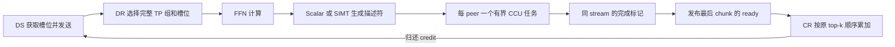

# A5 异步通信全特性集成版本

本分支在 `4d134dc` 累计优化版本上，将 CCU 连续段传输、SIMT 描述符和 epoch/credit 多槽控制接入实际调用链。原有 MTE、SIMT 路由、接收缓存、预取和分块优化继续保留。

分支为 `GuangyuZhu04/a5-async-cam-full-features`。新路径是显式开启的开发版本；编译、CPU 状态机和 Meta 检查不能替代 A5 设备通信验收。当前没有延迟、带宽、吞吐或模型精度提升结论。

## 选择运行路径

| 配置 | 数据路径 | 协议 |
| --- | --- | --- |
| 默认配置 | 累计优化版的四个 MTE 算子，保留各项资源门禁和回退 | compact-v2 |
| `a5_full_features=true` | DS/DR/CR 复用优化后的内核；CS 使用稳定注册的源缓冲、设备描述符、custom CCU 和完成发布 | AFDA5SLT version 1，每个槽内承载 compact routed 布局 |

在每个 Attention 和 FFN 进程的 `connector_extra_config` 中设置：

```json
{
  "dynamicQuant": 1,
  "attn_ranks_per_dp": 2,
  "hccl_buffer_size": 256,
  "a5_full_features": true,
  "a5_slot_count": 2
}
```

同时显式设置与域分配相同的 `HCCL_BUFFSIZE`，上例为 `256` MiB。模型、拓扑、dtype、quant、最大 token 容量和 slot 配置须在所有 rank 上一致。使用 eager 模式，保留 CAM async 对 Attention-side gate、静态 expert placement 和上下文并行的原有限制。

全特性路径要求 950 构建、匹配的 CANN/HCOMM，以及拓扑 layer 0 提供 UBC_TP 或 UBC_CTP 通道。每个会话由一个串行提交者使用一个 NPU stream；初始化结束后绑定首次数据调用的 stream。A3 构建没有注册新会话类。资源或通道不满足要求时，初始化失败；切换回默认配置需要重新启动通信域。

## 调用链



CS 的动态 offset、长度和目标 TP 组留在设备上。描述符表按全体 Attention rank 的固定槽排列，未参与的 peer 对应零长度段；host 无须为选出当前 TP 组读取每个 chunk 的 counts。CCU 内部循环处理每个 peer 的 expert 段，避免每个 expert 单独提交一次 host 任务。

CS 的准备、CCU 提交和完成发布都进入 torch-npu 的任务队列，并使用同一 runtime stream。规划状态与传输完成状态占用不同的 word；只有规划成功、全部 CCU 任务之后的完成标记也已写入，才能发布 ready。部分 host 提交失败不会把上一轮成功状态当成本轮完成。

SIMT 描述符采用原 P3 的稳定布局和有界 UB。完整 SIMT 预算为 213024B；不足时选择独立的 scalar prepare key，scalar arena 为 73760B。两种准备路径均调用原 checked planner。DS 路由统计的 SIMT 门禁仍按原 batch 和资源条件独立选择。

## 初始化和资源所有权

初始化分三阶段，由现有 PyTorch process-group Store 协调，不用待接管的数据窗口做 collective 握手：

1. `prepare()` 完成 MC2 窗口查询、实际窗口大小检查和窗口内存注册，再取得真实 token。所有 rank 在 Store 中交换窗口、token、dtype/shape fingerprint 和 rank 身份。
2. `configure()` 验证全域配置一致，清零各自窗口并分配 descriptor、status 和 FFN staging。所有 rank 确认本地 frame 初始化完成后，才继续注册通道。
3. `initialize()` 注册 CCU 通道与程序，完成 domain setup，并同步初始化数据。所有 rank 确认注册结束后，才允许数据面运行。

Store 只用于初始化。每次传输沿用设备 metadata 和 ready/credit，不增加每个 chunk 的 Store 请求或 CCU counts D2H。原 FFN worker 为选择模型层等用途已有的 metadata CPU 读取不由本功能移除。

会话以对象字段持有通信资源、creator、参数和 tensor，不引入进程级可变会话表。跨 C++ ABI 的接口只传 C/POD 类型：PyTorch 2.8 的 ABI1 扩展链接独立 ABI0 的 `libafd_cam_async_a5_transport.so`，后者使用匹配的 HCOMM。

正常关闭顺序为 `quiesce()` → 销毁拥有的 HCCL process group → `release_after_group_destroyed()`。关闭前须完成已提交传输。`abort()` 通过独立 DMA stream 通知设备轮询者退出，并禁止继续提交；它不签发 credit、不重置 epoch，也不把 CANN 的 Suspend 当作已提交 CCU 任务退休。已提交任务仍须真正停止访问资源后才能释放；设备错误路径采用整域/进程退出，不能原地重发或复用槽。

## 多槽语义和内存代价

每个域支持 2 至 8 槽，默认 2 槽。当前实现的槽粒度是完整通信轮次：DS 保存当前轮的路由统计，DR 可继续按完整 expert 分 chunk，CS 仅在最后 chunk 发布最终 ready，CR 完成按序归约后归还 credit。它没有启用按任意 contribution 到达顺序提前消费、提前归还小块槽位的路径；原 `OrderedCombineGate` 参考模型继续保留。

外层协议标识为 `AFDA5SLT`，与原独立实验的 `AFDSLOT4` 和旧 compact-v2 wire 均不同。控制记录带 domain、slot、epoch、request、状态及边界字段。发布过程先清 commit、写 body、再写 epoch commit；接收端通过 MTE2 重新读取 commit/body/commit。多 AIV 的数据阶段与控制阶段之间保留必要同步。8B commit 的设备原子性、远端可见性和跨引擎顺序仍属于真机验收内容。

同一 source 的 epoch 单调递增，耗尽时拒绝继续使用。槽位数据和控制记录相互隔离；FFN 在完整 TP 组之间公平轮询，非末 expert chunk 继续保有原 lease。回收必须匹配原 epoch，并等待输入读取、传输和输出归约完成。

设窗口大小为 W、world size 为 P、槽数为 S，则：

```text
固定头部与控制区 = 128 + S × 2 × 128
每槽 metadata    = P × 2 × 128
每槽 payload     = align_down((W - 固定头部与控制区) / S - 每槽 metadata, 128)
```

四算子的 host 校验使用每槽 payload 容量。`HCCL_BUFFSIZE` 是整个域的窗口大小，增加槽数会降低单槽容量。FFN 另持有一个稳定注册的 FP16/BF16 staging，大小约为 `receive_capacity × hidden_size × 2` 字节；源 tensor、metadata 和 ticket 通过 NPU event 保活。规划内存时需同时计入这些缓冲。

## 主要代码位置

| 位置 | 职责 |
| --- | --- |
| [async_cam.py](../../afd_plugin/connectors/npu/async_cam.py) | 配置选择、独立域、DS→CR/DR→CS ticket 传递和关闭顺序 |
| [cam_async_a5.py](../../afd_plugin/compat/npu/cam_async_a5.py) | CPU-safe 原生接口入口和三阶段 Store 初始化 |
| [torch_binding_cam_async_a5.cpp](../../csrc/npu/pybind/torch_binding_cam_async_a5.cpp) | `AsyncCamA5Context`、staging、提交队列、事件保活和槽位预留 |
| [cam_async_a5_transport.cpp](../../csrc/npu/runtime/cam_async_a5_transport.cpp) | 真实 HCOMM 注册、拓扑通道、CCU 有界循环和 stream 提交 |
| [cam_async_a5_contract.h](../../csrc/npu/ascend_kernels/utils/op_kernel/cam_async_a5_contract.h) | 调用 tag、外层 frame 布局和记录校验 |
| [cam_async_a5_control.h](../../csrc/npu/ascend_kernels/utils/op_kernel/cam_async_a5_control.h) | 设备端获取/选择/完成/credit、epoch 和 abort 轮询 |
| [cam_async_a5_prepare.h](../../csrc/npu/ascend_kernels/utils/op_kernel/cam_async_a5_prepare.h) | CS 的 scalar/SIMT 全局描述符表生成 |
| 四个 `afd_async_*/op_host` 和 `op_kernel` | 按 frame 容量 tiling、原数值内核前后的控制阶段；CS 新增 prepare keys 120/121 |
| [cam_async_checked_arithmetic.h](../../csrc/npu/ascend_kernels/utils/op_kernel/cam_async_checked_arithmetic.h) | 保留 uint64 溢出检查，避免 CANN 3101 链接到不可用的 `__multi3` |
| [pybind/CMakeLists.txt](../../csrc/npu/pybind/CMakeLists.txt)、[setup.py](../../setup.py) | 950 的 ABI 隔离编译、依赖库打包和 inplace 安装 |

P2/P3/P4 的共享算法已提升至 `utils/op_kernel/cam_async_*`；原 experimental 头文件转发到这些实现，避免运行时与参考测试分叉。原量化公式、scale 存储形式、稳定 expert/TP/token 布局，以及 FP32 分步乘加和最终舍入顺序继续保持。

## 构建和无卡检查

当前编译环境为 aarch64、CANN 9.0.0、Python 3.11、torch 2.8.0+cpu、torch-npu 2.8.0.post4，实际目标为 3101/dav-c310-vec。该环境没有 NPU，不构成 vLLM 模型 E2E 或设备通信资格。

```bash
source /usr/local/Ascend/cann-9.0.0/set_env.sh
export ASCEND_HOME_PATH=/usr/local/Ascend/cann-9.0.0
export ASCEND_CANN_PACKAGE_PATH="$ASCEND_HOME_PATH"
AFD_BUILD_JOBS=4 bash csrc/npu/build_aclnn.sh "$PWD" 950
SOC_VERSION=950 AFD_BUILD_ASCEND_OPS=1 AFD_SKIP_ACLNN_BUILD=1 MAX_JOBS=2 \
  python setup.py build_ext --inplace

SOC_VERSION=950 python -m pytest -o addopts='' -q -ra \
  tests/unit/package/test_cam_async_a5_full.py \
  tests/unit/package/test_cam_async_a5_control.py \
  tests/unit/compat/npu/test_cam_async_a5_context.py \
  tests/unit/connectors/test_async_cam_a5_wiring.py \
  tests/unit/compat/npu/test_cam_async_ops.py
```

控制测试执行生产 selector、record 和 credit 代码，底层内存访问由 CPU adapter 提供；它不模拟 CANN event、DMA 远端完成或 cache coherence。原有 P0/P1/P2/P3/P4、payload-tiling、CPU golden 和真实 Meta 回归也需保留。

本次无卡验收记录：

| 检查 | 结果和范围 |
| --- | --- |
| A5 完整包和扩展 | 新建源码目录构建、链接、打包及加载通过；包含 ABI0 CCU 库和 ABI1 PyTorch 扩展 |
| Wheel 打包 | 检出扩展、CCU 依赖库和 CANN vendor；在独立解包目录实际加载通过 |
| 实际 kernel 入口 | DS 包含 100/101/110/111，CS 包含 100/101/120/121；DS 和 CS 均检出真实 SIMT entry |
| 完整相关回归 | 298 passed、46 subtests passed，无 skip；包含原有算法模型、新控制路径、Store 握手、connector ticket、打包与真实 Meta |
| A3 针对性回归 | 独立目录构建 A2E/E2A 和四 async 算子，扩展及 20 项 Meta 检查通过；不含未改动的 GMM 构建资格 |
| NPU 执行 | 环境无 NPU；未运行通信、模型 E2E 或性能测试 |

构建日志、JUnit、源文件指纹和产物指纹保存在任务的验证记录中。无 Git 的编译快照仅在构建和打包测试进程设置 `SETUPTOOLS_SCM_PRETEND_VERSION_FOR_VLLM_AFD_PLUGIN`，没有修改项目版本或系统 CANN/Python 安装。

## 真机验收入口

[全特性精度入口](../../tests/npu/async_cam_a5_full.py) 复用原独立 CPU golden、metadata 校验和容差，不重新定义量化公式。下面的核数和 UB 是预检声明，运行前替换为目标平台实际核对的资源：

```bash
python tests/npu/async_cam_a5_full.py --dry-run \
  --aiv-count 48 --ub-budget-bytes 262144 --slots 2 \
  --dtype bf16 --dynamic-quant 1 --hidden-size 256 --capacity 16

timeout --kill-after=30s 600s torchrun --standalone --nproc_per_node=4 \
  tests/npu/async_cam_a5_full.py \
  --aiv-count 48 --ub-budget-bytes 262144 --slots 2 \
  --dtype bf16 --dynamic-quant 1 --hidden-size 256 --capacity 16
```

该入口按完整轮次依次验证，并轮换使用配置的槽位；并发在途轮次、延迟注入和压力性能需要单独的设备验收。至少覆盖 FP16/BF16、quant0/1、TP1/2/4、空 MoE、多个 expert chunk、多 DP、所有槽位反复复用和错误退出。通过后再在同一 A5、相同工作负载和计时边界下比较默认 MTE 路径与全特性路径。
