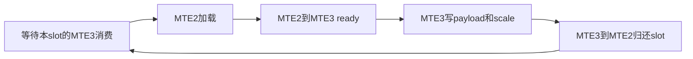

# A5 async CAM：P0 MTE 双缓冲与流水

2026-10-12；代码从B0提交 `7d773dcb5f1e73987d80b61f1191da2069057a34` 派生。B0分支 `GuangyuZhu04/a5-async-cam-baseline` 保持不变，本轮分支为 `GuangyuZhu04/a5-async-cam-mte-pipeline`。

本轮实现设计路线的第二步P0：combine send连续tile和dispatch recv逐行gather的双缓冲。compact-v2布局、路由、量化、加权combine顺序和完成协议保持B0。已有A5工程、A2E/E2A及原基线工作区没有修改。没有NPU卡，以下为编译、CPU调度模型和Meta证据，尚无设备数值或性能结论。

## 实现与约束

| 部分 | P0行为 |
| --- | --- |
| combine send | 将现有可复用UB按完整row分成两个tile；A5、两row可容纳且本AIV超过一row时流水。tile仍受expert/TP cell及AIV区间约束，可跨peer轮转slot |
| dispatch recv | 保留第一row和完整地址slice；第二row只占aligned地址slice尾部的空闲UB。A5、至少两row且第二row可容纳时启用；quantized payload与FP32 scale共用同一slot |
| fallback | A3沿B0串行；0/1 row及UB不足沿B0。未提高host/harness原最低UB要求，未减小receive容量或改协议 |
| 完成 | 所有slot Drain后才复用completion scratch/进入原通知代码；保留原SyncAll和ClearFlags位置，不增加每TP全核barrier |
| 其他算子 | dispatch send与combine recv的算数/传输未改；无CCU或SIMT路径 |

实现入口：[combine send](../../csrc/npu/ascend_kernels/afd_async_combine_send/op_kernel/afd_async_combine_send.h)、[dispatch recv](../../csrc/npu/ascend_kernels/afd_async_dispatch_recv/op_kernel/afd_async_dispatch_recv.h)、[共享事件与buffer规划](../../csrc/npu/ascend_kernels/utils/op_kernel/cam_async_mte_pipeline.h)。

combine send两个slot轮流执行下列依赖；dispatch recv使用相同handoff，量化scale写入也在归还slot之前：



每方向为两slot分配独占事件：`TPipe::AllocEventID<HardEvent>()` 与配对 `ReleaseEventID`，不用fixed0/1，也不把临时Fetch当租用。安装包 `dav_c310/kernel_tpipe_impl_c310.h` 明确Alloc占bitmap、Release清bitmap、Fetch仅借用空闲编号；对应两个方向为MTE2_MTE3和MTE3_MTE2。

循环没有逐tile等待Scalar。尾部消费所有busy slot的MTE3_MTE2 credit，再执行MTE2_S fence，使MTE3→MTE2→Scalar形成传递依赖；之后才释放事件、修改completion scratch或发布原flags。量化row的两次MTE3读取均先于MarkWritten。没有初始credit seed，因此空slot不会等待未发送的事件。Drain可重复调用而不重复释放。

DR中非末chunk的标记仍按B0时点写入，用于后续同流调用选择chunk；P0不是新的跨核payload-ready协议。最终源窗口释放仍由原ClearFlags的全核同步保护，后续同流算子也等待当前kernel完成。

## 验证结果

环境与B0一致：aarch64；CANN9.0.0、BiSheng clang15.0.5（2026-02-12），实际A5宏3101/dav-c310-vec；Python3.11.15、torch2.8.0+cpu、torch-npu2.8.0.post4。

| 检查 | 结果 |
| --- | --- |
| 真实SDK事件probe | Alloc/Release、两MTE事件方向、传递Scalar fence编译通过 |
| 最终A5 ACLNN包 | A2E/E2A与四个async完整编译、打包通过 |
| A5 PyTorch扩展 | 构建和实际加载通过 |
| A3针对性回归 | A2E/E2A与四个async编译通过；A3保持串行路径，不含本轮未修改的GMM |
| 最终测试 | **126 passed、46 subtests passed，无skip**；包含独立CPU golden、资源/打包、19项真实dispatcher/Meta和新增10项异步事件模型检查 |
| dry-run与lint | precision/performance dry-run通过；资源为明确声明的示例输入；Ruff及Markdown检查通过 |

[事件模型测试](../../tests/unit/package/test_cam_async_mte_pipeline.py)用普通C++编译器执行真实production `PipelineEvents`，通过注入backend生成MTE2/MTE3/Scalar三条独立FIFO，并随机选择可执行队列。每个非规划场景尝试256个seed，重复复用场景有16轮不同数据。测试检查未消费token、重复signal、deadlock、slot覆盖、payload/scale发布和lease清零。三个故障负例分别遗漏reuse wait、提前归还quant slot、遗漏尾部Scalar fence，模型均能检出。其队列模拟不能证明硬件DMA远端可见性或实际并行速度。

复现测试：

```bash
SOC_VERSION=950 python -m pytest -o addopts='' -q -ra \
  tests/unit/package/test_ascend_build_files.py \
  tests/unit/package/test_cam_async_build.py \
  tests/unit/package/test_cam_async_host_tiling.py \
  tests/unit/package/test_cam_async_mte_pipeline.py \
  tests/unit/compat/npu/test_async_cam_harness.py \
  tests/unit/compat/npu/test_async_cam_performance.py \
  tests/unit/compat/npu/test_async_cam_golden.py \
  tests/unit/compat/npu/test_cam_async_ops.py
```

正常checkout沿用 [B0构建命令](CAM_ASYNC_A5_BASELINE.md)。无.git的本轮隔离快照只在扩展构建进程设置 `SETUPTOOLS_SCM_PRETEND_VERSION_FOR_VLLM_AFD_PLUGIN=0.0.0+a5.mte.pipeline.7d773dc`；没有修改系统Python/CANN安装。

## 隔离与产物

本地新worktree：`C:/D_disk/Github/afd-plugin/.cache/a5-mte-worktree`。远端新目录：`/home/zhuguangyu/afd_async_a5_mte_pipeline_20261012_fwYN5o`；A5源码在source/，A3回归在a3_validation/。此前B0验证目录和已有A5项目未覆盖；临时启动的容器已恢复为exited状态。

本地产物/日志在原工作区的忽略目录 `.cache/a5-p0-validation/`，不纳入Git；也保留在上述远端新目录。

| 产物 | 大小 / SHA256 |
| --- | --- |
| AFD_ascend950.run | 697424B；0def797fafe6f5199d8e97d73c5e067ff8dec3671961c4d9bec25627e873da99 |
| _C_ascend.cpython-311-aarch64-linux-gnu.so | 399352B；467d2c5e58cc28a985c7bc5f46b1abb51efeab208d3726b764aa761ed6448a97 |
| A3回归包（远端） | e6dd664228426e5f821b49e213736f12ea8580af1956198db40b4890ccda79ef |

日志文件为 `aclnn_a5_p0_build.log`、`aclnn_a3_p0_regression.log`、`binding_a5_p0_build.log`、`p0_checks.log/xml` 和 `artifact_manifest.json`。最终kernel/helper源码指纹与编译快照一致，临时测试可执行文件和SDK声明stub未纳入发布代码。

## A5实机对照与保留条件

先通过B0的设备roundtrip，再验证P0同样的精度、稀疏/空rank、TP1/2/4、多expert chunk、量化scale、窗口复用和延迟注入。重点确认同slot的MTE3消费先于下一MTE2写入，尾部Scalar fence之后的原ready对应完整payload远端可见。A5实际可用事件数量、cache/remote DMA和超时/abort仍需设备证据。

B0与P0在独立进程加载各自checkout/配套vendor，使用相同卡、拓扑、CANN、输入、warmup/iterations、window和计时边界；不要在同一进程混装两套相同operator注册。以 `GuangyuZhu04/a5-async-cam-baseline` 的7d773dc为对照。

默认7/5-token小样本可能只走0/1-row fallback。下面是通过CPU预检的较大样本，适合在核数/UB已核对后尝试；其中48/196608是声明的示例资源，不是本轮硬件测量：

```bash
# 在对应checkout下，先跑precision；每个rank使用完全相同的配置。
timeout --kill-after=30s 600s torchrun --standalone --nproc_per_node=4 \
  tests/npu/async_cam_precision.py --soc-version 950 \
  --aiv-count 48 --ub-budget-bytes 196608 \
  --hidden-size 7168 --lengths 512 --capacity 1024 \
  --dtype bf16 --dynamic-quant 1

# 同配置分别测B0/P0；Profiler确认实际MTE重叠及路径选择。
timeout --kill-after=30s 600s torchrun --standalone --nproc_per_node=4 \
  tests/npu/async_cam_performance.py --soc-version 950 \
  --aiv-count 48 --ub-budget-bytes 196608 \
  --hidden-size 7168 --lengths 512 --capacity 1024 \
  --dtype bf16 --dynamic-quant 1 --measure-mode cycle \
  --warmup 5 --iterations 50 --output .cache/p0-cycle.json
```

比较per-operator和每轮跨rank最大延迟、p50/p95、tile数、event等待及MTE2/MTE3占用；小/大batch、不同H、quant0/1、热点/稀疏各自报告。CS将可用tile容量分半，可能增加小包和事件开销，收益必须来自真实重叠。若B0更快则保留B0，不据CPU调度模型宣称加速。后续CCU可替换该搬运路径；这版独立P0分支用于定位MTE流水的净收益。
